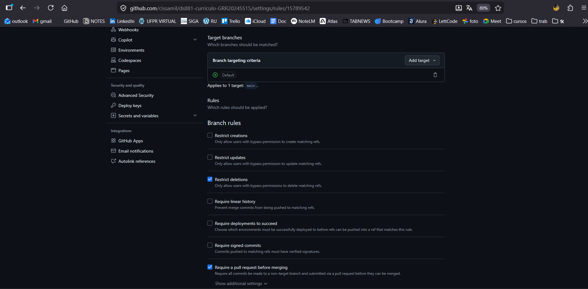

# 📄 Currículo Profissional DS881

[](https://github.com/cissamil/ds881-curriculo-GRR20245515/actions/workflows/main.yml)


Currículo profissional de **Clarissa Morita**, desenvolvido com [Astro](https://astro.build), conteinerizado com Docker e publicado automaticamente no GitHub Pages via GitHub Actions.

> Projeto da disciplina **DS881** · UFPR · GRR20245515

## 🔗 Link do Projeto

👉 **<https://cissamil.github.io/ds881-curriculo-GRR20245515/>**

## 📁 Estrutura do Repositório

```text
ds881-curriculo-GRR20245515/
├── .github/workflows/main.yml   # Pipeline de CI/CD (build + deploy no Pages)
├── branch-protection.png        # Print da regra de proteção da branch main
├── README.md
└── minor-meridian/              # Projeto Astro
    ├── public/                  # Arquivos estáticos (foto, favicon)
    ├── src/pages/index.astro    # Página do currículo
    ├── astro.config.mjs         # Configuração (site + base do GitHub Pages)
    ├── Dockerfile
    ├── docker-compose.yml
    └── package.json
```

## 🐳 Como Executar Localmente (Docker)

Pré-requisito: [Docker](https://docs.docker.com/get-docker/) instalado.

O `docker-compose.yml` fica dentro da pasta `minor-meridian`, então entre nela antes de subir o container:

```bash
cd minor-meridian
docker compose up --build
```

O site estará disponível em:
**<http://localhost:8080/ds881-curriculo-GRR20245515/>**

> ℹ️ O caminho `/ds881-curriculo-GRR20245515/` é necessário porque o `base` está configurado no `astro.config.mjs` para funcionar no GitHub Pages.

Para parar o container: `Ctrl + C` e depois `docker compose down`.

## 💻 Como Executar sem Docker (opcional)

Pré-requisito: Node.js **22.12** ou superior.

```bash
cd minor-meridian
npm install
npm run dev
```

| Comando           | O que faz                                   |
| ----------------- | ------------------------------------------- |
| `npm run dev`     | Servidor de desenvolvimento local           |
| `npm run build`   | Gera o site estático em `minor-meridian/dist/` |
| `npm run preview` | Pré-visualiza o build de produção           |
| `npm run lint`    | Verificação com `astro check`               |

## ⚙️ CI/CD (GitHub Actions)

O workflow [`main.yml`](./.github/workflows/main.yml) roda em todo **push** e **pull request** para a `main`:

1. **build-and-test**: instala as dependências, roda o `astro check` e faz o build do site.
2. **deploy**: somente em push na `main`: publica a pasta `dist/` no GitHub Pages.

## 🛡️ Governança e Branch Protection

A branch `main` está protegida com as seguintes regras:

1. Exigir **Pull Request** antes do merge.
2. Exigir que os **status checks** (CI/CD) passem com sucesso.



## 🧰 Tecnologias

- [Astro](https://astro.build)
- [Docker](https://www.docker.com) / Docker Compose
- [GitHub Actions](https://github.com/features/actions)
- [GitHub Pages](https://pages.github.com)

## 👩‍💻 Autora

**Clarissa Morita** · [GitHub](https://github.com/cissamil) · [LinkedIn](https://www.linkedin.com/in/clarissa-eri-morita-3ab688238/)
